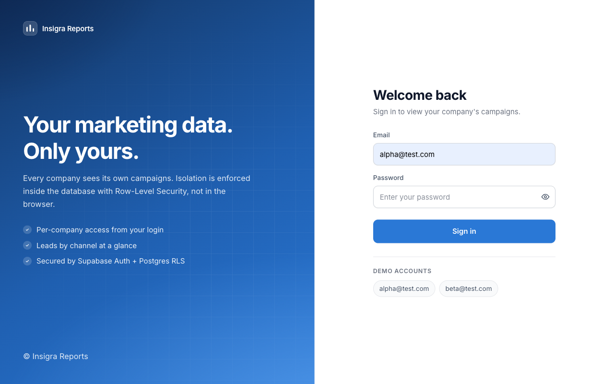
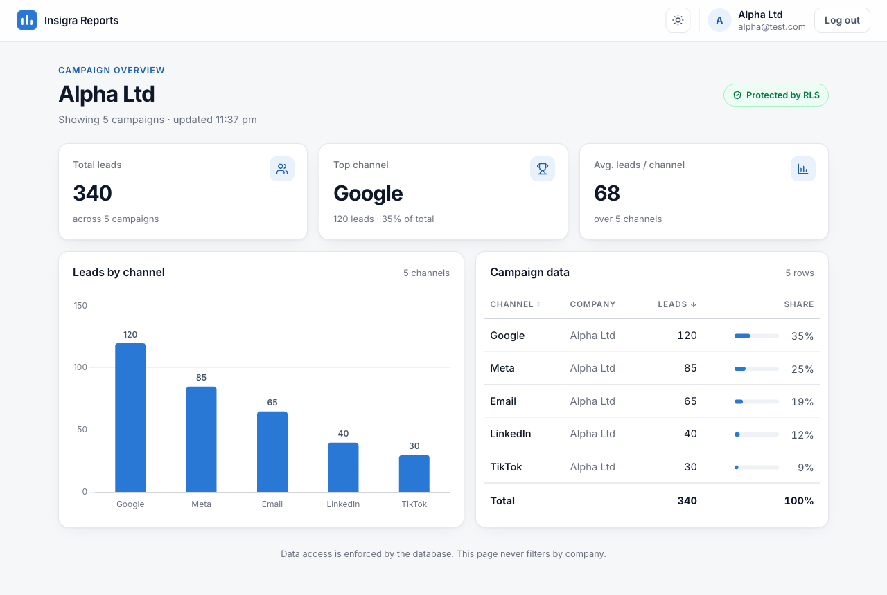
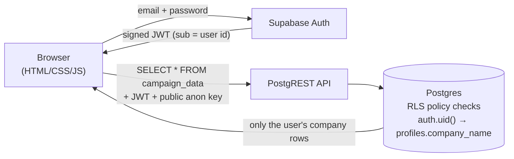
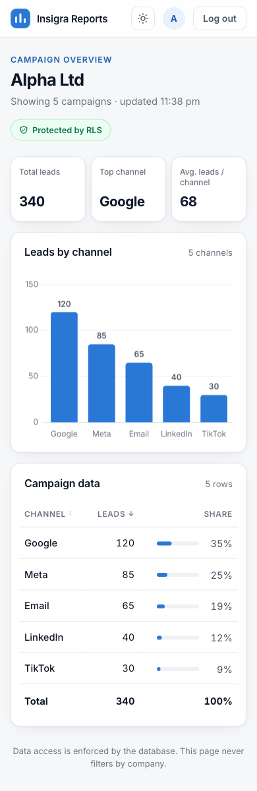

# Insigra Reports – Multi-tenant Campaign Dashboard

Each company logs in and sees **only its own** marketing data.
Isolation is enforced by **PostgreSQL Row-Level Security (RLS)** in Supabase. The frontend never filters by company.

**Live app:** https://sangamyo.github.io/insigra-rls-dashboard/

| Login | Dashboard |
|---|---|
|  |  |

## Test logins

| Email | Company | Expected result |
|---|---|---|
| alpha@test.com | Alpha Ltd | 5 rows, 340 leads, top channel Google |
| beta@test.com | Beta Ltd | 5 rows, 380 leads, top channel Meta |

Passwords are shared separately.

## Architecture



- **Frontend:** plain HTML/CSS/JS with no build step. It uses `supabase-js` for auth and data and Chart.js for the chart. It's hosted on GitHub Pages.
- **Backend:** Supabase (Postgres, Auth, auto-generated REST API).

## How the security works

```sql
create policy "Users read own company campaigns"
  on public.campaign_data for select to authenticated
  using (
    company_name = (select p.company_name from public.profiles p
                    where p.id = (select auth.uid()))
  );
```

1. On login, Supabase Auth returns a **signed JWT**, and every API request carries it.
2. Inside Postgres, `auth.uid()` reads the user id from that token. Changing the token breaks the signature, so the request is rejected with 401.
3. For each row, Postgres looks up the user's company in `profiles` and returns the row only if the names match.
4. The app runs `select` **without any company filter**. Someone who copies the public anon key and calls the API directly still only gets their own rows.
5. `campaign_data` has **no insert/update/delete policies**, so all writes are denied. The `anon` role has no policy at all and sees nothing.
6. `profiles` also has RLS: users can read **only their own** profile and can't change their company.
7. `(select auth.uid())` is wrapped in a sub-select so Postgres evaluates it once per query instead of once per row (from Supabase's performance advisor).

> The anon key in `config.js` is meant to be public. It grants only what RLS allows. The `service_role` key, which bypasses RLS, is never used in the frontend.

## Testing

| Level | How | Result |
|---|---|---|
| Database | [`supabase/03_test_rls.sql`](supabase/03_test_rls.sql) impersonates each user inside SQL | Alpha 5 / Beta 5 / anon 0, writes fail |
| API end-to-end | [`tests/rls-e2e.mjs`](tests/rls-e2e.mjs) gets real sessions for both users and calls the live REST API | **20/20 pass**: own rows only, cross-company query returns 0, insert 403, update/delete affect 0 rows, can't change own company, tampered JWT gets 401 |
| UI | Browser QA against a local mock of Supabase | **47/47 pass**: validation, loading, error, empty, sorting, theme, logout→switch user, XSS, mobile/tablet, keyboard |
| Linter | `supabase db advisors` | No security or performance issues |

Run the API test:

```bash
SB_URL=https://<ref>.supabase.co SB_ANON=<anon key> SB_SERVICE=<service_role key> node tests/rls-e2e.mjs
```

(The service_role key is used **only locally** to create test sessions without passwords.)

## Frontend features

- Login with validation, a show/hide password button, a loading state and friendly error messages
- KPI cards (total leads, top channel and its share, average per channel)
- Bar chart of leads by channel with values on the bars and tooltips, sorted high to low
- Sortable table with each row's share of total leads
- Placeholder outlines while loading, an error message with a retry button, and an empty state
- Light/dark theme (follows the OS setting, can be toggled, and is remembered)
- Responsive down to 375 px, keyboard accessible, respects reduced-motion settings
- All data is rendered with `textContent`, so a malicious value can't inject HTML



## Setup from scratch

1. Create a Supabase project.
2. **Authentication → Users → Add user:** add `alpha@test.com` and `beta@test.com` (tick *Auto Confirm User*).
3. **SQL Editor:** run [`01_schema_and_rls.sql`](supabase/01_schema_and_rls.sql), then [`02_seed.sql`](supabase/02_seed.sql). The seed can safely be re-run.
4. Run the blocks in [`03_test_rls.sql`](supabase/03_test_rls.sql) to verify isolation.
5. Put the Project URL and anon key in [`config.js`](config.js).
6. Serve locally with `npx serve .` or deploy the folder to any static host (GitHub Pages, Vercel, Netlify).

## Project structure

```
index.html                      login + dashboard markup
app.js                          auth, data fetch (no client-side filter), KPIs, table, chart
style.css                       design tokens, light/dark themes, responsive layout
config.js                       Supabase URL + public anon key
supabase/01_schema_and_rls.sql  tables, index, RLS + policies
supabase/02_seed.sql            10 campaign rows + profile links (idempotent)
supabase/03_test_rls.sql        SQL-level isolation tests
tests/rls-e2e.mjs               live API end-to-end test (20 checks)
docs/                           screenshots
```

## What I'd improve next

- Store a `company_id` (uuid foreign key to a `companies` table) instead of matching on the `company_name` text, so renaming a company can't break access.
- Move the tests into CI (GitHub Actions) against a local Supabase instance (`supabase start`).
- Add date ranges to campaigns and a date filter on the dashboard.
- Add roles (e.g. company admin vs viewer) through extra RLS policies.
